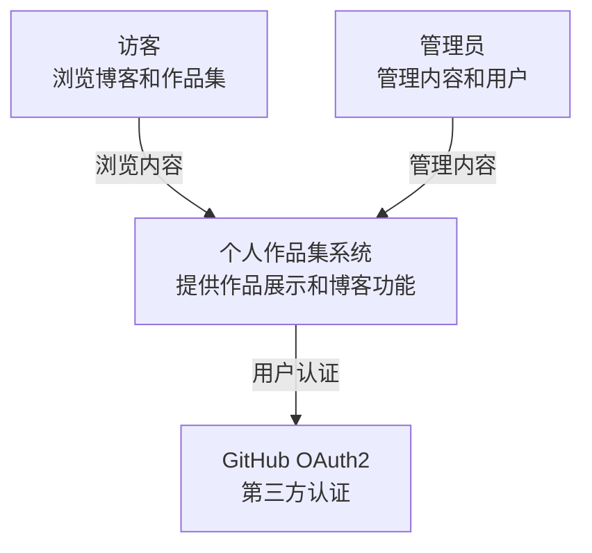
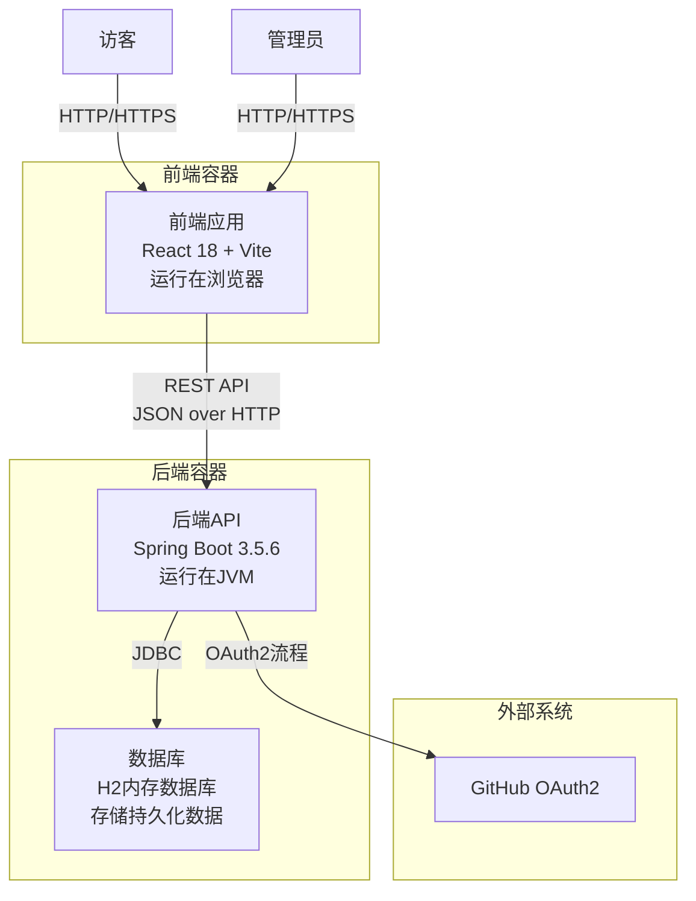
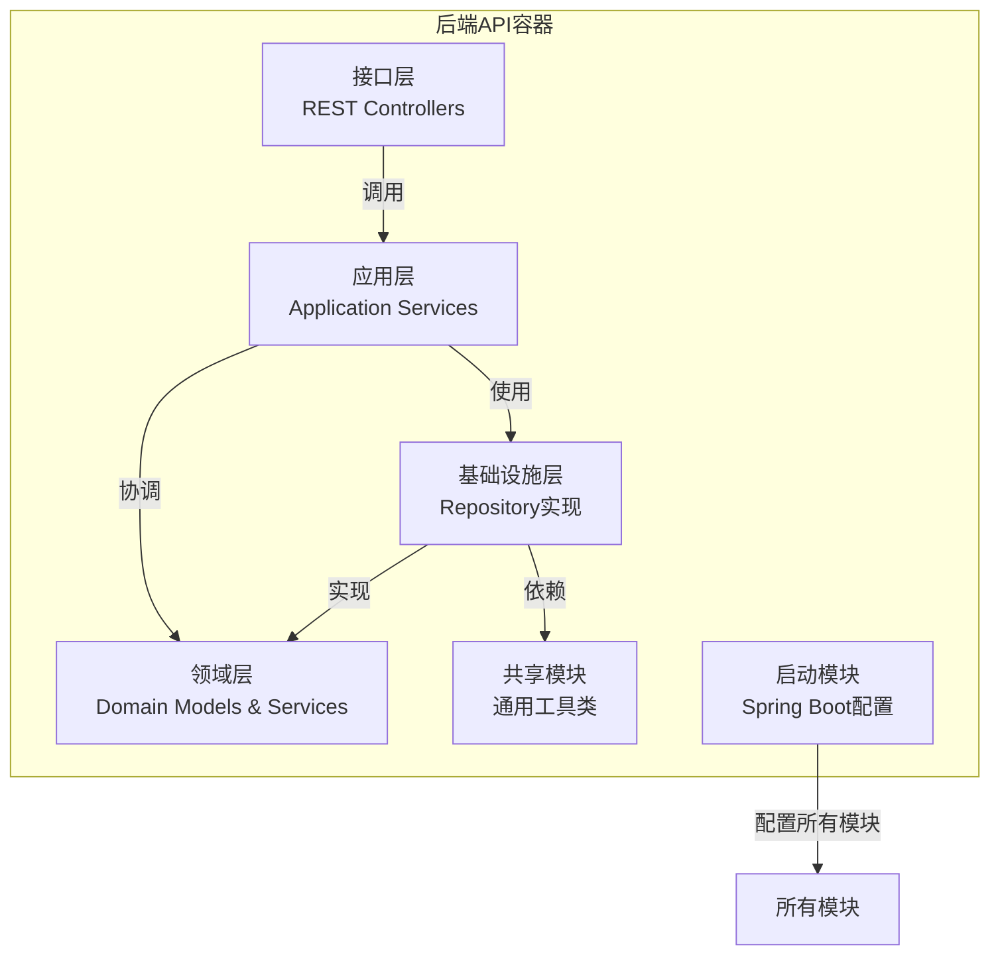
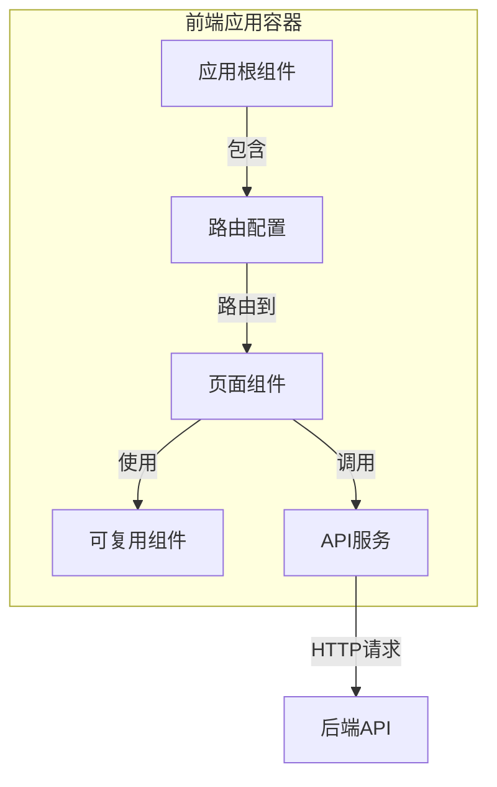
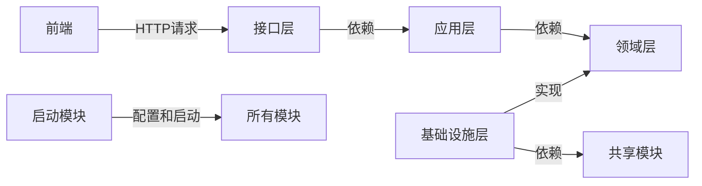

# Personal Portfolio 系统架构文档 (C4模型)

本文档使用C4模型描述个人作品集系统的软件架构。C4模型通过四个层次的抽象（上下文、容器、组件、代码）来展示系统结构。

## 目录
1. [系统上下文](#1-系统上下文)
2. [容器图](#2-容器图)
3. [组件图](#3-组件图)
4. [代码结构](#4-代码结构)
5. [技术栈](#5-技术栈)
6. [部署架构](#6-部署架构)

## 1. 系统上下文

系统上下文图展示了整个系统与外部用户和系统的关系。

**主要参与者：**
- **访客 (Visitor)**: 浏览博客内容、查看作品集
- **管理员 (Admin)**: 管理博客文章、管理用户
- **GitHub OAuth2**: 第三方认证服务

**系统：**
- **个人作品集系统 (Personal Portfolio System)**: 提供个人作品展示和博客功能

### 系统上下文图 (C4 Level 1)



## 2. 容器图

容器图展示了系统的宏观软件架构，识别主要的技术容器及其之间的通信。

**容器：**
1. **前端应用 (Frontend Application)**: React单页应用，运行在用户的浏览器中
2. **后端API (Backend API)**: Spring Boot REST API服务，提供业务逻辑
3. **数据库 (Database)**: H2内存数据库，存储应用数据

### 容器图 (C4 Level 2)



**通信协议：**
- 前端与后端: REST API (JSON over HTTP/HTTPS)
- 后端与数据库: JDBC
- 后端与GitHub: OAuth2

## 3. 组件图

组件图深入到每个容器的内部结构，展示主要组件及其关系。

### 3.1 后端API容器组件

后端采用领域驱动设计(DDD)的四层架构：



#### 3.1.1 接口层 (Interface Layer)
- **职责**: 处理HTTP请求和响应，REST API端点
- **主要组件**:
  - `BlogPostController`: 博客文章管理API
  - `AuthController`: 用户认证API
  - `CommentController`: 评论管理API
  - `NotificationController`: 通知管理API
  - `GlobalExceptionHandler`: 全局异常处理

#### 3.1.2 应用层 (Application Layer)
- **职责**: 协调领域对象和基础设施，实现用例
- **主要组件**:
  - `BlogPostAppService`: 博客文章应用服务
  - `BlogCreateAppService`: 博客创建应用服务
  - `CommentAppService`: 评论应用服务
  - `UserAuthAppService`: 用户认证应用服务
  - `UserRegistrationService`: 用户注册服务

#### 3.1.3 领域层 (Domain Layer)
- **职责**: 包含核心业务逻辑和领域模型
- **主要组件**:
  - **领域模型**:
    - `BlogPost`: 博客文章实体
    - `User`: 用户实体
    - `Comment`: 评论实体
    - `Notification`: 通知实体
  - **领域服务**:
    - `AuthenticationService`: 认证领域服务
    - `CommentDomainService`: 评论领域服务
    - `UserManagementService`: 用户管理领域服务
  - **仓储接口**:
    - `BlogPostRepository`: 博客文章仓储接口
    - `UserRepository`: 用户仓储接口
    - `CommentRepository`: 评论仓储接口
  - **领域事件**:
    - `BlogPostCreatedEvent`: 博客创建事件
    - `BlogPostPublishedEvent`: 博客发布事件

#### 3.1.4 基础设施层 (Infrastructure Layer)
- **职责**: 实现领域层定义的接口，提供技术实现
- **主要组件**:
  - **仓储实现**:
    - `BlogPostRepositoryImpl`: 博客文章仓储实现
    - `UserRepositoryImpl`: 用户仓储实现
    - `CommentRepositoryImpl`: 评论仓储实现
  - **持久化实体**:
    - `BlogPostEntity`: 博客文章持久化实体
    - `UserEntity`: 用户持久化实体
  - **MyBatis Plus Mapper**:
    - `BlogPostMapper`: 博客文章数据访问
    - `UserMapper`: 用户数据访问

#### 3.1.5 共享模块 (Shared Module)
- **职责**: 提供跨层使用的通用工具和组件
- **主要组件**:
  - `PageResult`: 分页结果封装
  - `BeanCopyUtils`: Bean拷贝工具
  - `ResponseCode`: 响应码枚举
  - `ApiResponse`: API响应封装

#### 3.1.6 启动模块 (Startup Module)
- **职责**: Spring Boot应用启动和配置
- **主要组件**:
  - `Application`: 主启动类
  - 各种配置类 (Security, MyBatis, Web等)

### 3.2 前端应用容器组件

前端采用React函数组件和模块化设计：



#### 3.2.1 页面组件 (Pages)
- `Home.jsx`: 首页
- `Login.jsx`: 登录页面
- `BlogHome.jsx`: 博客主页
- `About.jsx`: 关于页面
- `Contact.jsx`: 联系页面

#### 3.2.2 可复用组件 (Components)
- `Navbar.jsx`: 导航栏组件
- (其他可复用UI组件)

#### 3.2.3 API服务 (Services)
- `authService.js`: 认证相关API
- (其他API服务)

#### 3.2.4 应用配置
- `App.jsx`: 主应用组件，配置路由
- `main.jsx`: 应用入口点

## 4. 代码结构

### 4.1 项目模块结构

```
personal-portfolio/                   # 根项目 (Maven父项目)
├── backend/                         # 后端模块 (Maven父模块)
│   ├── domain/                      # 领域层模块
│   │   └── src/main/java/com/personal/portfolio/blog/domain/
│   │       ├── model/               # 领域模型
│   │       ├── repository/          # 仓储接口
│   │       ├── service/             # 领域服务
│   │       ├── event/               # 领域事件
│   │       └── context/             # 上下文
│   │
│   ├── application/                 # 应用层模块
│   │   └── src/main/java/com/personal/portfolio/blog/application/
│   │       ├── service/             # 应用服务
│   │       ├── dto/                 # 数据传输对象
│   │       ├── event/               # 应用事件
│   │       └── listener/            # 事件监听器
│   │
│   ├── infrastructure/              # 基础设施层模块
│   │   └── src/main/java/com/personal/portfolio/blog/infrastructure/
│   │       ├── persistence/         # 持久化实现
│   │       │   ├── entity/          # 持久化实体
│   │       │   ├── mapper/          # MyBatis Mapper
│   │       │   └── repository/      # 仓储实现
│   │       └── external/            # 外部服务集成
│   │
│   ├── interface/                   # 接口层模块
│   │   └── src/main/java/com/personal/portfolio/blog/interfaces/
│   │       ├── controller/          # REST控制器
│   │       ├── dto/                 # 请求/响应DTO
│   │       └── exception/           # 接口层异常
│   │
│   ├── shared/                      # 共享模块
│   │   └── src/main/java/com/personal/portfolio/
│   │       ├── page/                # 分页相关
│   │       └── util/                # 工具类
│   │
│   └── startup/                     # 启动模块
│       └── src/main/java/com/personal/portfolio/blog/
│           └── PersonalPortfolioApplication.java
│
├── frontend/                        # 前端项目
│   ├── src/
│   │   ├── components/              # 可复用组件
│   │   ├── pages/                   # 页面组件
│   │   ├── services/                # API服务
│   │   ├── App.jsx                  # 主应用组件
│   │   └── main.jsx                 # 应用入口
│   ├── public/                      # 静态资源
│   └── dist/                        # 构建输出
│
├── pom.xml                          # 根项目POM
└── README.md                        # 项目说明
```

### 4.2 关键依赖关系



**依赖倒置原则**: 领域层定义接口，基础设施层实现接口，确保领域层不依赖具体实现。

## 5. 技术栈

### 5.1 后端技术栈
- **Java版本**: 21
- **框架**: Spring Boot 3.5.6
- **构建工具**: Maven 3.6+
- **数据库**: H2 (开发环境)
- **ORM**: MyBatis Plus 3.5.14
- **安全**: Spring Security + OAuth2 Client
- **工具库**: 
  - Lombok: 减少样板代码
  - Hutool: Java工具库
  - Jackson: JSON处理
- **架构模式**: 领域驱动设计 (DDD)

### 5.2 前端技术栈
- **框架**: React 18
- **构建工具**: Vite
- **路由**: React Router DOM
- **HTTP客户端**: Axios
- **样式**: CSS3 + 响应式设计
- **代理**: Vite开发服务器代理

### 5.3 开发工具
- **版本控制**: Git
- **IDE**: IntelliJ IDEA / VS Code
- **包管理**: Maven (后端), npm (前端)
- **容器化**: Docker (支持)

## 6. 部署架构

### 6.1 开发环境部署
```
用户浏览器 <-> 前端开发服务器 (localhost:3000)
                    ↓ (代理)
后端服务器 (localhost:8080) <-> H2内存数据库
```

### 6.2 生产环境部署 (建议)
```
用户 <-> CDN/静态托管 (前端静态文件)
            ↓
负载均衡器/反向代理 (Nginx)
            ↓
后端应用集群 (Spring Boot) <-> 生产数据库 (MySQL/PostgreSQL)
            ↓
外部服务 (GitHub OAuth2)
```

### 6.3 容器化支持
项目包含Dockerfile：
- `backend/Dockerfile`: 后端应用容器化
- `frontend/Dockerfile`: 前端应用容器化
- `frontend/nginx.conf`: Nginx配置

## 7. 设计原则和模式

### 7.1 架构原则
1. **分层架构**: 清晰的DDD四层分离
2. **依赖倒置**: 高层模块不依赖低层模块，都依赖抽象
3. **单一职责**: 每个模块/类有明确的职责
4. **开闭原则**: 对扩展开放，对修改关闭
5. **领域驱动**: 业务逻辑集中在领域层

### 7.2 设计模式
1. **仓储模式**: 抽象数据访问层
2. **工厂模式**: 领域对象创建
3. **观察者模式**: 领域事件发布/订阅
4. **策略模式**: 可替换的业务算法
5. **DTO模式**: 数据传输对象

## 8. 扩展性和维护性

### 8.1 扩展点
1. **数据库迁移**: 从H2迁移到MySQL/PostgreSQL
2. **缓存集成**: 添加Redis缓存层
3. **搜索功能**: 集成Elasticsearch
4. **文件存储**: 集成云存储服务
5. **监控告警**: 添加应用监控

### 8.2 维护建议
1. **测试覆盖**: 确保各层有充分的单元测试
2. **文档更新**: 架构变更时同步更新本文档
3. **代码审查**: 遵循DDD和架构规范
4. **依赖更新**: 定期更新依赖版本

---

*文档版本: 1.0*
*最后更新: 2026-04-14*
*基于项目状态: personal-portfolio v1.0.0*